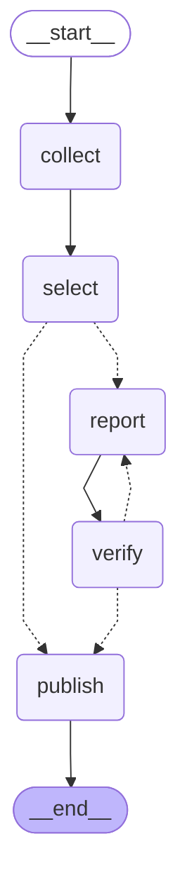

# 나만의 뉴스레터 에이전트 — 프로젝트 보고서

> 상태: **작성 중** (2026-10-29). `[작성 대기]` 표시는 사용자가 직접 쓰거나 실제 실행 결과가 있어야 채울 수 있는 부분이다. 이 표시가 남아 있는 항목은 아직 증거가 없다는 뜻이다.

- 분야: AI 에이전트·로컬 LLM 개발 소식
- 한 줄 요약: 소스 7곳(RSS/Atom·GitHub Releases·공식 API 3경로)에서 모은 글 중 독자 기준에 맞는 3~5건을 고르고, 본문을 읽어 요약·인사이트를 만든 뒤, 원문과 대조해 통과한 것만 Discord 로 발행하는 LangGraph 에이전트
- 제외 규정 6곳(OpenAI, DeepMind, TechCrunch, The Verge, MIT TR, AI타임스)은 후보에도 넣지 않았고, 다른 경로로 들어온 기사의 주소가 이 도메인이면 코드가 걸러낸다(`config.yaml`의 `excluded_hosts`).

## 1. 분야 및 독자 정의

**[작성 대기 — 사용자]** 이 분야를 고른 배경과 독자(페르소나)를 사용자 본인의 말로 적는다.

현재 `audience.yaml`에 들어 있는 **임시 초안**(Hermes가 채움, 사용자 문장으로 교체 예정):

- 독자: Windows PC와 AMD GPU에서 llama.cpp로 로컬 LLM을 돌리고, LangGraph로 에이전트 워크플로를 직접 실습하는 개발 학습자. 매일 아침 10분 안에 읽고, 오늘 내 실습 환경이나 코드를 바꿀지 판단하고 싶다.

## 2. 소스 채택표

2026-10-29에 후보 13곳을 직접 측정했다(`tools/survey_sources.py`, 읽기 전용 HTTP GET). 원자료는 `store/source_survey.json`, 이 표는 `tools/render_survey_table.py`가 그 JSON 과 사람이 적은 판정(`tools/survey_decisions.yaml`)을 합쳐 만든다.

- **관문**: G1 본문 확보(표본 3건 중 2건 이상에서 본문 600자 이상 추출) · G2 최근성(최근 7일 3건 이상) · G3 자동 접근 허용(robots.txt 허용, 피드 HTTP 200). 기준값은 강의 3강의 G1~G3를 따랐다.
- **키워드 열**: 최근 7일 글 중 독자 관련 키워드(llama, rocm, langgraph, agent 등)가 제목·요약에 들어간 비율이다. 관련도의 거친 근사치이며 채택 관문이 아니라 참고 수치다.
- **항목 열**: 피드가 한 번에 보여 주는 항목 수. 24h 항목 수와 같으면 피드가 하루치를 다 담지 못했을 수 있다(포화).

실측 시각 2026-10-29T12:14:43+09:00 · 요청 50건 · 본문 기준 600자 · 소스당 본문 표본 3건 · User-Agent `newsletter-agent-course/0.1 (personal learning project)`

| 소스 | 경로·tier | HTTP | 항목 | 24h/72h/7d | 최신(h) | 본문 | robots | 키워드 | 관문 | 판정 | 근거 |
|---|---|---|---|---|---|---|---|---|---|---|---|
| arXiv API (cs.CL, keyword agent) | API(arXiv) · 1 | 200 | 30 | 0/30/30 | 33.3 | 3/3 | n/a(API 약관  | 0.8 | G1o G2o G3o | **채택** | API 경로. 초록(abstract)이 응답에 들어 있어 본문 확보가 확실하다. 논문 위주라 선별에서 걸러질 가능성이 높아 소스당 상한을 둔다. |
| GitHub Releases langchain-ai/langgraph | GitHub Atom · 1 | 200 | 10 | 0/5/8 | 55.2 | 2/3 | allowed | 1.0 | G1o G2o G3o | **채택** | 1차 소스. 독자가 직접 쓰는 도구라 키워드 일치율 1.00. 발행량은 적고(오늘 48시간 창에는 0건) 릴리스 노트는 피드 본문을 우선 쓴다. |
| Hugging Face Blog | RSS · 1 | 200 | 891 | 1/3/6 | 12.3 | 3/3 | allowed | 0.17 | G1o G2o G3o | **채택** | 1차 소스. 오픈 모델·도구의 직접 발표가 실린다. 관문 세 개 통과. |
| Hacker News (Algolia API, query llama.cpp) | API(HN) · 2 | 200 | 30 | 2/3/4 | 6.9 | 3/3 | n/a(API 약관  | 0.75 | G1o G2o G3o | **채택** | API 경로. 쿼리 llama.cpp 하나 기준 7일 4건이지만 키워드 일치율 0.75. 운영에서는 쿼리 3개(llama.cpp·langgraph·local llm)를 합친다. |
| Latent Space | RSS · 2 | 200 | 20 | 2/6/12 | 7.4 | 3/3 | allowed | 0.42 | G1o G2o G3o | **채택** | 2차 소스. AI 엔지니어링 주간 정리. 키워드 일치율이 높은 편(0.42). 관문 통과. |
| Simon Willison's Weblog | Atom · 2 | 200 | 30 | 4/8/15 | 3.9 | 3/3 | allowed | 0.2 | G1o G2o G3o | **채택** | 2차 소스. 7일 15건으로 발행 빈도가 가장 높고 모델·도구의 실사용 후기가 많다. 관문 통과. |
| The Decoder | RSS · 2 | 200 | 10 | 8/10/10 | 7.9 | 3/3 | allowed | 0.5 | G1o G2o G3o | **채택** | 2차 소스. 범용 AI 뉴스 보강용. 피드 10건이 전부 72시간 안이라 하루치를 다 담지 못할 수 있다(포화). 관문 통과. |
| AMD ROCm Blogs | RSS · 1 | 404 | — | -/-/- | — | — | allowed | — | G1x G2x G3x | **탈락** | 피드 주소가 HTTP 404. 대체 주소는 확인하지 못했다. |
| GeekNews | RSS · 2 | 200 | 50 | 47/50/50 | 0.6 | 0/3 | allowed | 0.16 | G1x G2o G3o | **탈락** | 피드는 정상(50건, 24시간 47건)이지만 기사 페이지 표본 3건이 모두 HTTP 403 이라 본문을 받을 수 없다. |
| GitHub Releases ggml-org/llama.cpp | GitHub Atom · 1 | 200 | 10 | 10/10/10 | 0.7 | 2/3 | allowed | 0.5 | G1o G2o G3o | **탈락** | 피드 10건이 전부 24시간 안이라 하루치를 담지 못한다(포화). 글자 수 관문은 2/3 로 통과했지만 추출문을 직접 열어 보니 변경 설명 한 줄과 빌드 파일 목록·로그인 배너뿐이라 요약할 본문이 아니다(수치와 실제 내용의 괴리). |
| GitHub Releases ROCm/ROCm | GitHub Atom · 1 | 200 | 10 | 0/0/0 | 2519.6 | 2/3 | allowed | — | G1o G2x G3o | **탈락** | 최근 7일 0건, 최신 글이 약 105일 전(2,520시간)이다. 정체된 소스. |
| LangChain Blog | RSS · 1 | 200 | 0 | 0/0/0 | — | 0/0 | no_robots | — | G1x G2x G3o | **탈락** | HTTP 200 이지만 피드가 아닌 HTML(약 212KB)이 돌아와 항목 0건. 추측한 주소가 틀렸을 수 있으며 대체 주소는 확인하지 못했다. |
| Reddit r/LocalLLaMA | Atom · 2 | — | — | -/-/- | — | — | disallowed | — | G1x G2x G3x | **탈락** | robots.txt 가 자동 접근을 금지(disallowed)한다. 허용되지 않은 접근이라 요청을 보내지 않았다. |

**측정에서 배운 점**

1. 글자 수 관문(G1)은 llama.cpp Releases를 통과시켰지만, 추출문을 직접 열어 보니 변경 설명 한 줄과 빌드 파일 목록·로그인 배너였다. 숫자 기준은 "요약할 본문인가"를 보장하지 못해 사람이 판정을 뒤집었다.
2. llama.cpp Releases와 The Decoder는 피드가 10건만 보여 주는데 그 전부가 24~72시간 안이다. 하루 한 번 수집하면 앞선 글을 놓칠 수 있으며, 이는 강의 3강이 경고한 문제와 같다.
3. 허용되지 않은 접근은 숫자 이전의 문제다. Reddit 은 robots.txt 가 금지해 요청 자체를 보내지 않았고, GeekNews 는 robots.txt 는 허용하지만 기사 페이지가 403 을 돌려줬다.
4. 채택 소스의 경로 유형은 RSS/Atom(4곳), GitHub Releases(1곳), 공식 API(2곳)로 세 가지다. 스크래핑은 쓰지 않았다.

## 3. 선별 로직 설계

**중요도 판단 문장** (`audience.yaml`의 `importance`)

> AI 에이전트·LLM을 만들거나 쓰는 개발자에게 직접 관련된 소식이면 중요하다. 새 모델 공개, 에이전트·코딩 에이전트 설계와 실사용 후기, 로컬 실행, LLM 평가·메모리 같은 연구처럼 내 실습에 참고할 수 있는 것.

작성 과정: 사용자가 표본 30건에 정답 라벨(중요 19·보통 8·무관 3)을 먼저 달았고, Hermes가 '중요'와 '무관'의 공통점을 읽어 후보 문장 3개를 만들었으며, 사용자가 그중 위 문장을 골랐다. 사용자가 처음부터 직접 쓴 문장은 아니다. 후보에는 처음 임시로 쓰던 더 엄격한 문장("이번 주 안에 내 도구를 바꿔야 할 만큼 구체적인 변화")도 있었으나 라벨과 어긋나 제외되었다. 문장을 같은 30건을 본 뒤 정했으므로, 라벨 평가는 그 표본에 맞춰진 결과이다.

**2단계 구조**

| 단계 | 하는 일 | 설정 |
|---|---|---|
| 예선 | 후보를 소스가 섞이도록 무작위(실행 id 시드)로 섞어 묶음으로 나누고, 묶음마다 독자 기준으로 상위 5건을 고른다. 6·7등은 경계 사례로 기록만 한다 | `batch_size: 20`, `prelim_picks: 5`, `prelim_borderline: 2` |
| 본선 | 예선 통과분을 한 화면에 놓고 5건 + 여유 3건의 순위를 받는다 | `final_target: 5`, `final_ask_extra: 3` |
| 코드 규칙 | 모델이 준 순위에서 같은 사건 라벨은 1건만, 한 소스는 최대 2건만 남기고, 3건에 못 미치면 소스 상한만 풀어 채운다 | `max_per_source: 2`, `final_min: 3` |

**묶음 크기를 20으로 한 이유**: 제목과 200자 요약 20건이 약 3천 토큰이라 한 호출에서 항목을 고르게 볼 수 있다고 판단했다. 40건이면 입력이 길어져 중간 항목을 놓칠 위험이 커진다는 것이 강의 5강의 listwise 한계다. 다만 20과 40을 직접 비교 실험하지는 않았으므로 이 값은 설계 판단이지 측정 결과가 아니다.

**모델에 맡기지 않는 것**: 최종 건수, 같은 사건 중복 제거, 소스 상한, 숫자 형식 검사는 모델의 제안이 아니라 코드가 확정한다(`graph.py`의 `enforce_rules`). 모델이 실패한 묶음은 최신순으로 대체해 파이프라인이 멈추지 않게 했다.

**기준이 의도대로 동작했다는 증거** — **[작성 대기]** 정답 라벨 30건(`eval/labels.json`) 대비 정밀도·재현율(`tools/eval_selection.py`)과 `store/metrics.jsonl`의 `select_prelim`·`select_final` 기록을 여기에 넣는다. 라벨이 30건뿐이라 통계적 입증이 아니라 동작 확인으로만 적는다.

**알려진 한계와 보류한 개선** (2026-10-29 사용자 결정: 지금은 현재 방식 그대로 가고, 아래는 한계로 기록한 뒤 추후 수정 여부를 판단한다)

1. 선별은 제목과 피드 요약(200자)만 본다. 본문은 선별된 뒤 `report`에서야 읽는다. Hacker News 항목은 요약이 "N점·댓글 M개"뿐이라 제목만으로 판단된다.
2. 모델이 매기는 `score`(1~10)는 기록용이다. 순서는 모델이 준 목록 순서를 그대로 쓰므로 날마다 같은 잣대를 보장하지 못한다.
3. 예선 묶음끼리는 서로 비교되지 않는다. 강한 글이 한 묶음에 몰리면 다른 묶음의 괜찮은 글이 밀릴 수 있다(섞기, 경계 사례 기록, 평가의 예선 재현율로 완화만 한다).
4. 예선은 항상 묶음당 5건을 고르므로 "오늘은 쓸 만한 소식이 없다"를 선별 단계에서 표현하지 못한다. 조용한 날 카드는 수집 0건이거나 전부 검수 탈락일 때만 나온다.
5. 같은 사건 중복 제거는 모델이 붙인 `event` 라벨의 글자가 같을 때만 작동한다.

**보류한 개선: 본선 점수 기준선.** 점수 기준표를 프롬프트에 넣고, 상위 3건은 항상 확보하되 4·5번째는 기준선(예: 7점)을 넘어야 포함하는 방식(`enforce_rules`에 `min_score`, `config.yaml`에 `select.min_final_score`)을 검토했으나 이번에는 넣지 않았다. 이유: ① 현재 방식의 평가 결과 없이 바꾸면 무엇이 좋아졌는지 말할 근거가 없다. ② 모델 점수는 7~9점에 몰리는 등 보정이 정밀하지 않아 기준선이 잘 안 걸릴 수 있다. ③ 표본 30건은 '중요'가 19건(63%)이라 이 표본으로는 효과를 보기 어렵다. 평가에서 모델 점수가 라벨(중요/보통/무관)을 실제로 구분하고 보통·무관이 선별 건에 섞이는 것이 확인될 때 다시 판단한다.

## 4. 파이프라인 구조도

아래 그림은 실제 코드로 컴파일한 그래프에서 뽑았다(`store/graph_mermaid.txt`). 점선은 조건부 연결이다.



**노드와 State 흐름**

| 노드 | 읽는 State | 쓰는 State | 하는 일 |
|---|---|---|---|
| collect | `hours` | `collected`, `log` | 소스 7곳을 돌며 시간 창·미래 날짜·제외 도메인·중복을 걸러 기사 목록을 만든다. 소스별 응답 상태를 기록해 조용한 누락을 막는다 |
| select | `collected` | `shortlisted`, `picked`, `log` | 예선→본선→코드 규칙. 뽑힌 기사가 없으면 곧장 publish 로 간다 |
| report | (기사 한 건) | `drafted`(누적), `log` | 기사별 병렬(`Send`). 본문을 확보해 headline·summary·why 를 만든다 |
| verify | `drafted`, `picked` | `verdicts`(누적), `round`, `verified`, `rejected` | 형식·사용자 규칙 → 숫자 대조 신호 → 원문 대조(모델). 불합격이면 재생성으로 되돌아간다 |
| publish | `verified` 외 집계 | `published`, `log` | Discord 임베드 발송. 상태를 dry_run / sent / failed / skipped_no_webhook 으로 구분한다 |

**예외 처리**

| 상황 | 동작 | 시험 |
|---|---|---|
| 소스 하나가 실패(404·403·파싱 오류) | 그 소스만 `error`로 기록하고 나머지는 계속 | 오프라인 시험 통과 |
| 후보가 0건 | 모델을 부르지 않고 "수집 0건 — 소스 응답 문제일 수 있음" 카드를 보낸다. '조용한 날'과 '장애'를 구분 | 오프라인 시험 통과 |
| 예선 모델 호출 실패 | 그 묶음은 최신순으로 대체 | 오프라인 시험 통과 |
| 본문이 600자 미만 | 요약하지 않고 취재에서 제외 | 오프라인 시험 통과 |
| 형식 위반(영어 요약·금지 표현·문장 수 등) | 모델 검수 비용을 쓰지 않고 바로 재생성 | 오프라인 시험 통과 |
| 검수 불합격 | 사유를 붙여 재생성 1회 → 재검수 → 그래도 불합격이면 그 기사는 스킵 | 오프라인 시험 통과 |
| 검수 모델 장애 | 검수하지 못한 글은 내보내지 않는다(실패 시 닫힘), 재생성하지 않음 | 오프라인 시험 통과 |
| 발행 실패 | `status: failed`와 HTTP 코드를 기록, 종료 코드 2 | 오프라인 시험 통과 |

위 표의 "오프라인 시험"은 가짜 모델·가짜 네트워크로 **분기가 올바르게 갈라지는지**만 확인한 것이다. 실제 모델이 환각을 잡는지는 별도로 측정한다(5절 `[작성 대기]`).

**State**: `run_id`, `hours`, `collected`, `shortlisted`, `picked`, `drafted`(리듀서: 이어 붙임), `verdicts`(리듀서), `round`, `verified`, `rejected`, `published`, `log`(리듀서). 재생성 초안까지 `drafted`에 쌓이므로, 통과·최종 스킵은 `derive_outcome`이 기록 전체에서 매번 다시 계산한다.

## 5. 실행 기록

**[작성 대기]** 최종 검수를 거쳐 정상 발행된 결과 화면 캡처, `store/metrics.jsonl` 요약(수집 건수·선별 건수·검수 통과 건수·발행 응답), 검수 시험(오염 샘플) 적발 수치를 여기에 넣는다. 현재까지 실제 모델 호출과 Discord 발송은 한 번도 하지 않았다.

## 6. 프로젝트 회고

**[작성 대기 — 사용자]** 가장 공들인 부분과 앞으로 보완하고 싶은 점을 사용자 본인의 말로 적는다.

## 부록 A. 재현 방법

```bash
cd my-newsletter
python -m venv .venv                 # Python 3.12 에서 시험함
.venv/Scripts/activate               # Windows (macOS·Linux: source .venv/bin/activate)
pip install -r requirements.txt
cp .env.example .env                 # OPENAI_API_KEY, DISCORD_WEBHOOK_URL 입력 (.env 는 Git 에 올라가지 않음)
python run.py                        # 수집→발행 전체를 돌리되 발송 없이 내용만 확인(dry-run)
python run.py --publish              # 검수를 통과한 내용을 Discord 로 실제 발송
python -m unittest discover -s tests -t .   # 오프라인 시험 26건 (모델·네트워크 불필요)
```

## 부록 B. 파일 구성

| 파일 | 역할 |
|---|---|
| `graph.py` | State, 5개 노드, 코드가 확정하는 규칙, 그래프 조립 |
| `run.py` | 실행 스크립트(`--publish`, `--hours`) |
| `audience.yaml` | 독자·중요도 문장·제외 조건·검수 기준(사용자 편집 영역) |
| `config.yaml` | 소스 목록, 모델명·주소, 묶음 크기, 상한 등 운영 설정 |
| `store/metrics.jsonl` | 실행·선별·검수·발행 기록(한 줄에 이벤트 하나) |
| `store/source_survey.json` | 소스 실측 원자료 |
| `collectors.py`, `net.py`, `llm.py`, `metrics.py`, `publisher.py`, `config.py` | 수집·HTTP·모델 호출·기록·발행·설정 로드 |
| `tools/` | 소스 실측, 채택표, 표본 추출, 라벨링 위젯, 선별 평가, 검수 시험 |
| `tests/` | 오프라인 시험 26건 |
| `eval/` | 정답 라벨용 표본·라벨·평가 결과 |

## 부록 C. 한계와 아직 확인하지 못한 것

- 실제 모델로 파이프라인을 끝까지 돌린 기록, 라벨 평가, 검수 시험, Discord 발송은 아직 없다(5절).
- 자동 예약 실행(GitHub Actions)은 구현하지 않았다. 과제의 필수 5단계에 포함되지 않아 이번 범위에서 뺐다.
- 소스 측정은 2026-10-29 한 시점의 값이다. 피드의 발행량과 접근 정책은 바뀔 수 있다.
- 글자 수 관문(G1)이 놓치는 경우가 있어 사람의 확인이 필요했다(2절).
- 선별 단계의 한계 5가지와 보류한 본선 점수 기준선 개선은 3절에 적었다.
